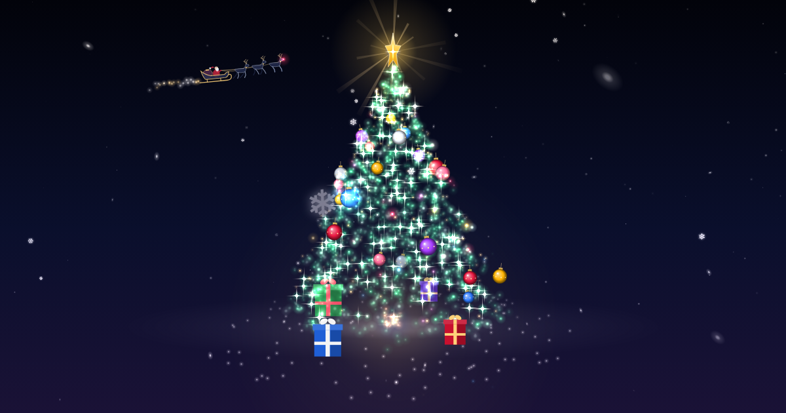

# 🎄 별빛 캐럴 트리 (Starlight Carol Tree)

[](https://sweetinsam-boop.github.io/xmas-tree/)
[]()
[](LICENSE)

PC 모니터·태블릿·스마트폰 화면에 켜두기 좋은 **인터랙티브 크리스마스트리 웹 모션 그래픽**입니다.  
외부 라이브러리나 빌드 없이 **단일 HTML 파일(Canvas 2D + Web Audio)**만으로 동작합니다.

👉 **바로 열기 (설치 불필요)**: https://sweetinsam-boop.github.io/xmas-tree/



---

## ✨ 주요 기능

- **그래픽 ↔ 문자(ASCII) 트리 자동 교대**
  - 20초 장면마다 점·글로우 그래픽 버전과 모든 요소가 문자(`* + ^`, `MERRYCHRISTMAS`, `메리크리스마스`, `NOEL★`, `❄`, `★`)로 그려지는 버전이 부드럽게 교대합니다.
- **6종 카메라 연출 & 글자 변신**
  - 정면 궤도, 아래서 올려다보기, 위에서 내려다보며 흩어졌다 모이기, `MERRY CHRISTMAS` 글자 변신, 별 클로즈업, 원경 눈 내리는 풍경이 매 바퀴 랜덤 순서로 이어집니다.
- **트리 뒤 먼 하늘을 나는 루돌프 & 산타 썰매**
  - 반짝이는 빨간 코 루돌프와 순록 3마리가 끄는 썰매가 별가루 꼬리를 남기며 트리 뒤 밤하늘을 주기적으로 가로지릅니다. (문자 버전에서도 ASCII 썰매로 전환)
- **입체 눈보라 & 눈 쌓임**
  - 강약 주기와 34초마다 좌우로 부는 돌풍, 회전하는 눈 결정(`❄`), 보케 눈송이, 바닥과 트리 가지에 서서히 쌓이는 눈 효과를 표현합니다.
- **클릭 / 터치 인터랙션**
  - 화면 어디든 클릭·탭하면 별빛 불꽃과 파동 링이 퍼지며 펜타토닉 오르골 차임이 울립니다.
  - **꼭대기 별 클릭**: 황금 폭죽과 강한 펄스
  - **오너먼트 클릭**: 해당 방울 반짝임 + 같은 색 불꽃
  - **산타 썰매 클릭**: 별가루 폭포 + 썰매 방울 소리
  - **상단 밤하늘 클릭 (산타 대기 중일 때)**: 산타 썰매 즉시 출격!
- **캐럴 합성 & 화면 꺼짐 방지**
  - 퍼블릭 도메인 캐럴 3곡(*징글벨*, *고요한 밤 거룩한 밤*, *We Wish You a Merry Christmas*)을 Web Audio API로 실시간 합성하며, 박자에 맞춰 전구와 장식이 반응합니다.
  - Screen Wake Lock API로 켜두기 용도를 지원하고, `prefers-reduced-motion` 접근성 설정과 저사양 기기 자동 입자 조절을 포함합니다.

---

## 🚀 사용 방법

### 1. 웹에서 바로 실행 (추천)
브라우저에서 [https://sweetinsam-boop.github.io/xmas-tree/](https://sweetinsam-boop.github.io/xmas-tree/) 를 열고 화면을 탭하면 캐럴이 시작됩니다.  
오른쪽 위 버튼으로 **소리 켜기/끄기(`♪`)**와 **전체 화면(`⛶`)**을 전환할 수 있습니다.

### 2. 로컬에서 실행
저장소를 내려받은 뒤 `index.html`을 브라우저로 열면 바로 실행됩니다.

```bash
git clone https://github.com/sweetinsam-boop/xmas-tree.git
open xmas-tree/index.html
```

---

## 🛠 기술 스택

- **HTML5 Canvas 2D**: 3D 원근 투영, 가산 합성(`lighter`), 오프스크린 스프라이트 캐시
- **Web Audio API**: 실시간 오실레이터·노이즈 합성 캐럴 + 클릭 차임벨 (iOS 무음 모드 대응 `audioSession.type = 'playback'`)
- **Zero Dependencies**: 외부 JS/CSS 번들러나 프레임워크 없음 (Google Fonts만 선택 로드)

---

## 🌍 English Summary

**Starlight Carol Tree** is a zero-dependency, single-file interactive Christmas tree screensaver built with HTML5 Canvas 2D and Web Audio API.

- **Live Demo**: https://sweetinsam-boop.github.io/xmas-tree/
- **Highlights**: Seamless morphing between particle graphics and ASCII text mode, 6 cinematic camera scenes (`MERRY CHRISTMAS` morphing included), flying Santa & Rudolph sleigh across the distant sky, dynamic snowstorm & accumulation, interactive click/tap starbursts & chimes, and synthesized public-domain Christmas carols.

## 📄 License

MIT License — 자유롭게 사용, 수정, 공유할 수 있습니다.
